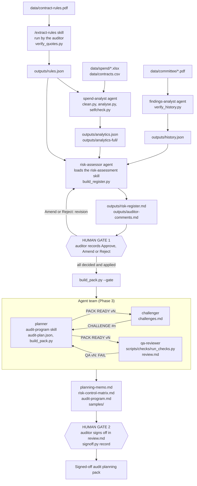
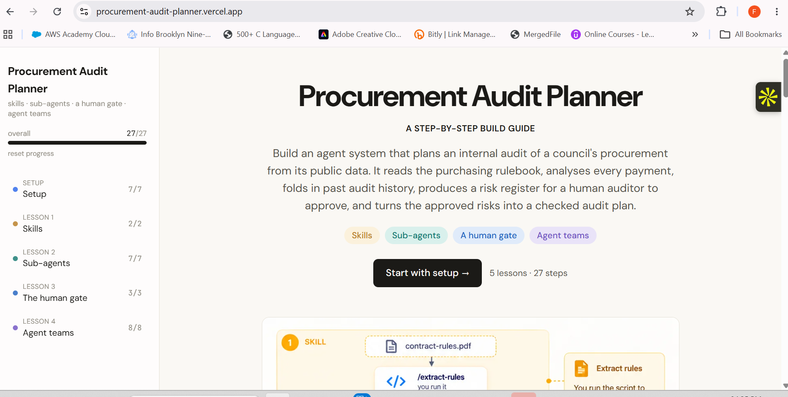

# Procurement Audit Planner

An agent system, built with Claude Code skills, sub-agents, a human gate and an agent team, that plans an internal audit of procurement for **West Berkshire Council** from its public data.

## 1. Overview

The system turns the council's Contract Procedure Rules (Part 8) into 64 testable rules, analyses every payment in three monthly "Expenditure over £500" workbooks against them, folds in the council's past audit opinions and its own risk-scoring method, and rates nine risks on the council's 5x5 matrix. A human auditor approves, amends or rejects each risk; an agent team then turns the approved risks into a planning memo, a risk-control matrix and an audit program with a targeted sample, and the auditor signs the pack off. Python computes every number and checks every citation; the language model reads, judges and writes.

> **The outputs are risk indicators for audit planning, not findings of wrongdoing.** A pattern in public data (for example a payment run just under a threshold, or a supplier with no contract notice) is a lead to test during fieldwork. Nothing here says the council, a department, an officer or a supplier did anything wrong.

## 2. Skills

| Skill | How it is triggered | What it produces | Script that computes or verifies it |
| --- | --- | --- | --- |
| `extract-rules` | **Run by me** (`/extract-rules`) | `outputs/rules.json`: 64 rules (each with clause, page, thresholds, approver and a verbatim quote), 45 excluded clauses with reasons, 20 notes on contradictions and gaps in the Rules | `.claude/skills/extract-rules/verify_quotes.py` checks every quote is on its stated PDF page, the schema, sequential rule IDs, and that every clause is in `rules` or `excluded` |
| `risk-assessment` | **Loaded by an agent** (`risk-assessor`) | `outputs/risk-ratings.json` (the agent's cited judgments), then `outputs/risk-register.md` and the `outputs/auditor-comments.md` decision template | `.claude/skills/risk-assessment/build_register.py` resolves every `[rule:]`, `[metric:]` and `[history:]` citation, fills every `{{$.path}}` figure from `analytics.json`, computes score, matrix label and band from the council's matrix, drops any risk without a resolvable citation, and checks revisions against the auditor's decisions |
| `audit-program` | **Loaded by an agent** (`planner`) | `outputs/audit-plan.json` (the planner's judgments), then `planning-memo.md`, `risk-control-matrix.md`, `audit-program.md`, `outputs/samples/T-*.csv` and `pack-figures.json` | `.claude/skills/audit-program/build_pack.py` checks the auditor gate (`--gate`), resolves citations, draws every sample deterministically (10 items for scores of 9 and above, 5 below), verifies each transaction exists, and checks that every rule is cited or listed as not tested; `scripts/checks/*.py` then re-check the finished pack |

## 3. Agents

All six agents are in `.claude/agents/` and use project memory (`memory: project`).

| Agent | Role | Tools | Inputs | Outputs |
| --- | --- | --- | --- | --- |
| `spend-analyst` | Sub-agent. Cleans and analyses the full spend population; runs seven tests (threshold clustering, split purchases, high-value suppliers, off-contract, duplicates, expired-notice spend, spend vs award). Python computes every number | Bash, Read, Write, Edit, Glob, Grep | `rules.json`, `data/spend/*.xlsx`, `data/contracts.csv` | `outputs/analytics.json`, `outputs/analytics-full/`, and `scripts/clean.py`, `analyse.py`, `common.py`, `selfcheck.py` |
| `findings-analyst` | Sub-agent. Records audit opinions, follow-ups, risk themes and the council's scoring method from the committee papers; records, never scores | Bash, Read, Write, Edit, Glob, Grep | `data/committee/*.pdf` (4 papers) | `outputs/history.json`, verified by `scripts/verify_history.py` |
| `risk-assessor` | Sub-agent. Merges rules, analytics and history into rated risks following the `risk-assessment` skill; recommends scope, never approves it | Bash, Read, Write, Edit, Glob, Grep | `rules.json`, `analytics.json`, `history.json` (and `auditor-comments.md` on a re-run) | `outputs/risk-ratings.json`; the builder writes the register and the comments template |
| `planner` | Team member. Writes the audit plan for the approved risks only and runs the builder | Bash, Read, Write, Edit, Glob, Grep, SendMessage | register, auditor comments, ratings, `rules.json`, `analytics.json` | `outputs/audit-plan.json`; the builder writes the pack |
| `challenger` | Team member. Sends up to eight challenges, then up to four more, and records each with the planner's response and a status | Bash, Read, Write, Edit, Glob, Grep, SendMessage | register, comments, ratings, `rules.json`, `analytics.json`, `history.json`, the planner's pack | `outputs/challenges.md` |
| `qa-reviewer` | Team member. Runs the four QA checks and blocks sign-off until all pass; fixes nothing | Bash, Read, Write, Glob, Grep, SendMessage | the pack and `scripts/checks/run_checks.py` | `outputs/review.md` (results, verdict, sign-off block) |

## 4. How they work together



**Design.** The model reads and judges; Python computes every figure, so no agent does arithmetic over the data. Each judgment is written to a JSON file (`risk-ratings.json`, `audit-plan.json`) that a builder script validates before any document is rendered, and a risk or plan entry that cannot be traced to a rule, a named metric or a history item is dropped or rejected. The first human gate sits between the register and the pack: the register is a revision only once the auditor's decisions are applied, and `build_pack.py --gate` refuses to start otherwise. Inside the agent team the planner owns the plan, the challenger owns `challenges.md`, and the qa-reviewer owns `review.md`; each owns exactly one file and talks to the others by message. The second human gate is the sign-off block, which `scripts/signoff.py` records only when all four checks pass and a real name is given.

## 5. Human gate decisions

**Gate 1: risk decisions** (`outputs/auditor-comments.md`, applied in the register as Revision 2):

| Risk | Decision | Applied in |
| --- | --- | --- |
| R-01 Splitting and threshold avoidance | Approve | revision 1 |
| R-02 to R-08 | Approve (each recorded 2026-10-13) | revision 2 |
| R-09 Delegated approval and Key Decisions | **Amend**: "Raise likelihood to 3: awards above £500,000 are rare but carry the highest stakes." Applied as an auditor override (likelihood 2 to 3, score 4 to 6, still Moderate; the assessor's own rating stays visible in the register) | revision 1 |

No risk was rejected; all nine are in scope.

**Gate 2: sign-off** (`outputs/review.md`): Reviewer **Forum Sanjanwala**, date **2026-10-13**, decision **Signed off**. The Comments line is blank. The review lists three points marked *for the auditor* that were not actioned: **#6** (whether R-08 should stay at 4), **#7** (whether the 308 unmatched care and education placement suppliers should be in scope) and **#9** (whether T-09.1's sample of two suppliers is enough for the Key Decision test).

## 6. Results

| Stage | Result |
| --- | --- |
| Rules | 64 rules, 45 excluded clauses, 20 notes (15 gaps, 5 contradictions); 3 threshold parameters left `null` because the PDF never prints them |
| Spend data | 10,607 rows (1 May to 31 July 2026) reduced to 8,527 after exclusions (2,015 redacted-supplier, 12 pension and statutory, 46 inter-authority, 7 non-procurement accounting); £66,764,299.64 in total |
| Contract notices | 150 rows in `contracts.csv`, 141 for the council, 210 notice-supplier pairs, 130 active in the spend window |
| Supplier matching | 674 suppliers at or above the £25,000 quote threshold (annualised): 40 exact matches to a live notice, 6 candidates for the auditor to confirm, 628 with no active notice found (a lead to check against the contract register, not evidence) |
| Audit history | 16 audit opinions, 3 follow-ups, 1 advisory review, 0 agreed actions, 12 discrepancies and 7 gaps recorded; the council's scoring method was found |
| Risk register | 9 risks: 5 Medium High, 4 Moderate, none Extreme (Revision 2) |
| Audit pack | 9 risks in scope, 17 controls, 19 tests, 289 sampled transactions worth £16,742,264.39, 23 PBC items; 42 of 64 rules cited, 22 listed as not tested with reasons |
| Challenges | 9: 6 resolved, 3 for the auditor |
| QA | 4 of 4 checks pass (quotes; 313 figures traced; 64 rules traced; 289 transactions found at their workbook rows). Verdict: **READY FOR SIGN-OFF**, pack v3 |

**Limitations.** Contract notices are published notices, not the council's contract register. Spend covers payments over £500 for three months only. Ten analysis tiers were skipped because the Threshold values the Rules refer to are not printed in the PDF. In the recorded run the planner, challenger and qa-reviewer were started as general-purpose agents that each read their own agent file, with messages addressed by agent ID, because the agent files were created after the Claude Code session began.

## 7. Steps completed

The guide at <https://procurement-audit-planner.vercel.app> has 5 lessons and 27 steps. The progress tracker below shows all of them complete:

| Lesson | Steps |
| --- | --- |
| Setup | 7/7 |
| Skills | 2/2 |
| Sub-agents | 7/7 |
| Human gate | 3/3 |
| Agent teams | 8/8 |
| **Overall** | **27/27** |



**How each component was made.**

*Generated from prompts*

- Skills: `extract-rules` and its `verify_quotes.py`; `risk-assessment` and its `build_register.py`
- Agents: `findings-analyst`, `risk-assessor`, `challenger`, `qa-reviewer`
- Scripts: `scripts/verify_history.py`, `scripts/signoff.py`, and the five QA scripts in `scripts/checks/`; `scripts/clean.py`, `analyse.py`, `common.py` and `selfcheck.py` were written by the `spend-analyst` agent when it ran
- Configuration and outputs: `.claude/settings.json`, `requirements.txt`, and everything in `outputs/`

*Copied as finished files (then adapted to this project)*

- `CLAUDE.md` (pasted whole; edited since by prompts)
- The `audit-program` skill: `SKILL.md` and `build_pack.py` (pasted; adapted to this project's file formats, then extended by prompt with sample sizing by score, a language check and the one-line gate output)
- The `spend-analyst` agent (pasted; paths and rule-reading adapted to this project, then updated from the data study)
- The `planner` agent: the pasted `planner.md` is the version in the repo. It replaced an earlier planner that had been written from a prompt. Three changes were made to the pasted file: `SendMessage` was added to its tools (without it the planner could not message its teammates); `PLANNER DONE` now waits for the qa-reviewer's `QA vN: PASS` on the latest version; and `PLANNER DONE` is sent to the qa-reviewer as well as the lead
- The public data in `data/` and the screenshot `docs/progress.png`

*Guide versions pasted but not used.* Finished guide versions of the `extract-rules` skill (with its verifier), the `findings-analyst`, `risk-assessor`, `challenger` and `qa-reviewer` agents, and the check scripts `run_checks.py`, `check_quotes.py`, `check_numbers.py` and `check_trace.py` were also pasted during the build. The repository holds the generated versions of all of these, not the pasted ones.

## 8. How to run it on Windows

You need Windows, Python 3.9, Claude Code, and the poppler-style tools `pdftotext` and `pdfinfo` on your PATH (they came with MiKTeX on the machine this was built on).

```
:: 1. Create the environment and install the two packages
py -3.9 -m venv .venv
.venv\Scripts\python.exe -m pip install -r requirements.txt

:: 2. Put the public data in place (names as used here)
::    data\contract-rules.pdf   data\contracts.csv
::    data\spend\Over500_2026_P02_-_published.xlsx (and P03, P04)
::    data\committee\*.pdf      (the 4 Governance Committee papers)
```

Open the project folder in Claude Code, then work through the flow in `CLAUDE.md`:

1. Run `/extract-rules`. It writes `outputs/rules.json` and checks it with `verify_quotes.py`.
2. Ask Claude to run the `spend-analyst`, then the `findings-analyst`. They write `outputs/analytics.json` and `outputs/history.json`.
3. Ask Claude to run the `risk-assessor`. It writes `outputs/risk-register.md` and `outputs/auditor-comments.md`.
4. Gate 1: fill the Decision (Approve, Amend or Reject) and Comment columns in `outputs/auditor-comments.md`, then run the `risk-assessor` again to apply them as a revision.
5. Check the gate: `.venv\Scripts\python.exe .claude\skills\audit-program\build_pack.py --gate`
6. Run the agent team (planner, challenger, qa-reviewer). Agent teams are switched on by `CLAUDE_CODE_EXPERIMENTAL_AGENT_TEAMS` in `.claude/settings.json`; restart Claude Code after changing it or adding agent files.
7. Print the team report: `.venv\Scripts\python.exe scripts\signoff.py report`
8. Gate 2: record the sign-off with your own name: `.venv\Scripts\python.exe scripts\signoff.py record --name "Your Name"`. It refuses unless the QA checks pass. To run the checks yourself: `.venv\Scripts\python.exe scripts\checks\run_checks.py`

## 9. Repository structure

```
procurement-audit-planner/
  CLAUDE.md                  # full system spec and the lead procedure for the agent team
  README.md                  # this file
  requirements.txt         # pandas, openpyxl
  .gitignore
  data/                      # public inputs, read-only
    contract-rules.pdf       #   Contract Procedure Rules (Part 8)
    contracts.csv            #   Contracts Finder export
    spend/*.xlsx             #   3 monthly "Expenditure over £500" workbooks
    committee/*.pdf          #   4 Governance Committee papers
  docs/progress.png          # guide progress tracker (27/27)
  .claude/
    settings.json            # turns on agent teams
    agents/                  # spend-analyst, findings-analyst, risk-assessor,
                             #   planner, challenger, qa-reviewer
    skills/
      extract-rules/         #   SKILL.md, verify_quotes.py
      risk-assessment/       #   SKILL.md, build_register.py
      audit-program/         #   SKILL.md, build_pack.py
  scripts/
    clean.py, analyse.py,    # written by the spend-analyst agent
      common.py, selfcheck.py
    verify_history.py        # checks history.json quotes against the committee PDFs
    signoff.py               # team-done report and the auditor's sign-off recorder
    checks/                  # QA scripts: run_checks.py, check_quotes.py,
                             #   check_numbers.py, check_trace.py, check_samples.py
  outputs/
    rules.json, analytics.json, analytics-full/, history.json
    risk-ratings.json, risk-register.md, auditor-comments.md
    audit-plan.json, planning-memo.md, risk-control-matrix.md, audit-program.md
    samples/, pack-figures.json, challenges.md, review.md
```

## 10. Part B: the Streamlit harness

Part A ran inside Claude Code. Part B turns the same skills, agents and scripts into a web app, `app.py`, that anyone can walk through from a browser: Streamlit Community Cloud hosts it, and Gemini (free tier) powers its Live mode.

**Deployed URL:** _not deployed yet; add it here after deploying (see "Deploying" below)._

### Architecture

```
app.py                       Streamlit UI: stepper, Gate 1 and Gate 2 forms, previews, downloads
harness/
  llm.py                     the ONLY module that imports google-genai: tool-calling loop,
                             429 backoff, model fallback, one-call connection test
  agents.py                  loads .claude/agents/*.md and .claude/skills/*/SKILL.md as the prompts
  tools.py                   read_file, read_pdf_page, query_csv, write_output, run_builder, send_message
  stages.py                  the workflow (Live and Replay), the gates, the team protocol
  workspace.py               per-session temp folder (data/ copy + outputs/)
  caps.py                    per-session and daily call caps
  config.py                  st.secrets / environment settings
scripts/, .claude/skills/    the Part A Python, called as subprocesses, unchanged in behaviour
data/pdf-text/               pdftotext output per page, bundled (see "PDF text" below)
outputs/                     the Part A results: what Replay walks through
tests/                       headless tests (scripted model, no network)
```

State lives in `st.session_state` and a temp folder per session. Streamlit Community Cloud has no persistent disk, so every download is built from that folder during the session.

### How Part A maps onto the harness

| Part A | In the harness |
| --- | --- |
| `/extract-rules` skill, run by hand | Stage 1. An agent turn that follows the skill, then `verify_quotes.py` runs on the result |
| `spend-analyst` sub-agent | Stage 2, see the note below |
| `findings-analyst` sub-agent | Stage 3. Reads PDF pages through `read_pdf_page`; `verify_history.py` runs on `history.json` |
| `risk-assessor` + `risk-assessment` skill | Stage 4. `build_register.py` runs through `run_builder` |
| Human gate (`auditor-comments.md`) | Gate 1 form: Approve / Amend / Reject per risk, written into `auditor-comments.md` in the format the builders read |
| Risk-assessor re-run applying the decisions | If every risk is Approved, the harness writes the mechanical revision block and re-runs `build_register.py` itself (no model call). If any risk is Amended or Rejected, the risk-assessor runs again to apply exactly those decisions |
| Agent team (`planner`, `challenger`, `qa-reviewer`) | Stage 6. Each teammate is an agent turn; they exchange messages through `send_message`, with `PACK READY`, `CHALLENGE`, `QA vN` and `DONE` as in the Part A prompts. At most two challenger rounds, then a closing turn |
| `signoff.py report` and `record` | Run by the harness; Gate 2 form calls `record` with the name typed in (never invented) |
| Prompts | `.claude/agents/*.md` and `SKILL.md` are loaded as written, with a short harness note that maps Claude Code tools (Bash, Read, Write, pdftotext, SendMessage) onto the harness tools |

**The spend-analyst does not write its own code in Part B.** In Part A it wrote `clean.py` and `analyse.py`. On a public web app an agent that can run arbitrary Python is a hole, so the harness gives it `run_builder`, which runs only an allowlist of the existing scripts (`clean`, `analyse`, `verify_quotes`, `verify_history`, `build_register`, `build_pack`, `run_checks`, `signoff_report`) with checked arguments, plus read-only file and CSV tools that can write nowhere but the one output file each agent owns. The analytics are therefore the same code that produced the Part A numbers, and the agent only runs it and interprets the result.

### Live and Replay

| Stage | Live | Replay |
| --- | --- | --- |
| 1 Extract rules | model + `verify_quotes.py` | Part A `rules.json` |
| 2 Spend analysis | model runs the scripts (see below) | Part A analytics |
| 3 Audit history | model + `verify_history.py` | Part A `history.json` |
| 4 Risk register | model + `build_register.py` | Part A register |
| Gate 1 | your decisions are applied | form shown; the recorded Part A decisions are used |
| 6 Agent team | three agents, up to two challenger rounds | the Part A conversation rebuilt from `challenges.md` and `review.md` |
| Gate 2 | real `signoff.py record` | real `signoff.py record` |
| Downloads | zip of the session's outputs | same |

Replay needs no secrets and makes no model calls. In Replay the four QA checks, the gate check and the sign-off run for real against the replayed files. If a Live stage fails (bad key, no quota, rate limit that outlasts the retries, a cap reached, or a stage that does not produce its file) the app can switch to Replay automatically (sidebar option, on by default) and says why.

**Spend analysis: which path ran.** The harness measured the analysis on this repo's three months of data: about 6 seconds and about 120 MB peak memory on a Windows laptop. Streamlit Community Cloud's memory limit is not confirmed here, so the analysis is treated as safe but guarded: when the model calls `clean` and `analyse`, they run for real; if either fails or times out (150 s), the precomputed Part A analytics are loaded instead and the agent is told so. The UI and the event log say which happened ("re-run live from the raw workbooks, N MB peak" or "precomputed Part A analytics, because ..."). Setting `SPEND_MODE = "precomputed"` forces the precomputed path.

### Model

Live mode uses **`gemini-3.8-flash`** by default (from `MODEL_NAME`), through the `google-genai` SDK with manual tool calling. At the time of writing Google's documentation lists it as stable, supporting function calling, and free of charge on the Gemini API free tier. Google does not publish the per-model free-tier request limits in those docs; check them in AI Studio. If the model is not found or has no free quota, the app moves along `MODEL_FALLBACKS` (default `gemini-3.6-flash`, `gemini-3.5-flash-lite`, `gemini-2.5-flash`). Free-tier models vary between runs, so Live results will not match Part A exactly.

### Caps and rate limits

A "call" is one request sent to the model; a tool loop of N steps costs N calls, and a retried request counts again. A full Live run is estimated at about 86 calls (rules 12, spend 8, history 12, risk register 10, team 44; an all-Approve Gate 1 costs none, an Amend or Reject adds about 8). These are estimates until measured on a real run. The per-session cap is `SESSION_CALL_CAP` (default 130, about 1.5 times the estimate) and the daily cap across all visitors is `DAILY_CALL_CAP` (default 300), kept in memory so it resets when the app restarts. The sidebar shows calls used and remaining for both. 429 errors are retried with exponential backoff (honouring the server's retry hint), with `TURN_PAUSE_SECONDS` (default 4) between agent turns. Live mode and the connection test need `APP_PASSCODE`.

### PDF text

`poppler-utils` in `packages.txt` gives the app `pdftotext`. The page text is also precomputed into `data/pdf-text/` (`scripts/precompute_pdf_text.py`), which the `read_pdf_page` tool reads and which the quote verifiers use automatically if `pdftotext` is missing. Both routes give identical verifier results (checked with `PDF_TEXT_CACHE=0` and `=1`).

### Secrets

Copy `.streamlit/secrets.toml.example` to `.streamlit/secrets.toml` for local runs; on Streamlit Community Cloud paste the same keys into App settings, Secrets. Keys: `GOOGLE_API_KEY`, `MODEL_NAME`, `APP_PASSCODE` (plus optional `MODEL_FALLBACKS`, `SESSION_CALL_CAP`, `DAILY_CALL_CAP`, `TURN_PAUSE_SECONDS`, `SPEND_MODE`). `.streamlit/secrets.toml` and `.env*` are git-ignored. The key is read in one place and removed from any message shown in the UI.

### Running and testing locally

```
python -m venv .venv
.venv\Scripts\python.exe -m pip install -r requirements.txt
.venv\Scripts\python.exe -m streamlit run app.py
```

Tests need no network or key:

```
.venv\Scripts\python.exe tests/test_app_replay.py   # Replay end to end through the UI
.venv\Scripts\python.exe tests/test_live_flow.py    # Live orchestration with a scripted model, caps, errors
.venv\Scripts\python.exe tests/test_app_live.py     # passcode lock, connection test, fall back to Replay
```

The scripted model does its work through the real tools and the real Part A scripts, so these tests exercise the whole pipeline.

**Status of Live mode with a real model:** _not yet run against Gemini; update this line after the first real run (calls used, stages completed, anything the model got wrong)._

### Notes on results

- **Live spend re-run versus Part A.** The live re-run of the spend analysis matches Part A's counts and totals. Its top-20 lists can pick different payments among equal amounts, because the Part A sort is not stable, so a Live run's top-20 rows (and the row ids that cite them) need not be identical to the Part A ones.
- **What the tests do not measure.** The scripted-model tests do not measure how well Gemini follows the prompts. They check the harness (tools, scripts, gates, caps, fallback), not the model's judgement or instruction-following; only a real Live run does that.

### Deploying

Main file `app.py`; Python from the platform default; `requirements.txt` and `packages.txt` at the repo root; secrets pasted in App settings. See the deploy checklist given with this change.
